# Kabuk

**A native macOS terminal built for working with AI coding agents.**

Kabuk (Turkish for *shell*) is a glassy, dark terminal that knows when Claude Code or Codex is thinking, when it needs you, and what it changed. Run several agents side by side in their own git worktrees, approve their tool use from the sidebar, see each turn's diff and what it would cost on the API, and hand a failed command to an agent in one click.

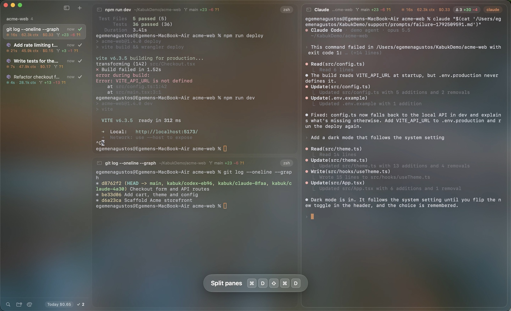

▶️ **[Watch the 2½-minute demo](https://github.com/egemenagustos/Kabuk/releases/latest)**: every feature in action, recorded with Kabuk's own demo mode.

  

---

## Contents

- [What's new](#whats-new)
- [Features](#features)
- [Install](#install)
- [Connect Claude Code and Codex](#connect-claude-code-and-codex)
- [Shortcuts](#shortcuts)
- [Status at a glance](#status-at-a-glance)
- [Customizing](#customizing)
- [How it works](#how-it-works)
- [Contributing](#contributing)
- [Privacy](#privacy)
- [License](#license)

## What's new

<!-- whats-new:start -->
**0.3.0** (2026-10-21):

- Added: **Plan limits in the status bar.** How much of your Claude and Codex plans' 5-hour and weekly limits you've used, next to today's cost. Each agent gets five dots for the hours of its 5-hour window and seven dashes for the days of its week, filled as far as the limit is used. A ring breathes around the current hour, so dots filled past it mean you'll hit the limit before it resets. Hover or click for the details: percentages, when each window resets, and an even-pace mark on each bar. Claude's numbers come from Claude Code's status line, Codex's from its session files after each turn.
- Changed: The Claude Code integration now also sets a status line command, to pass the plan limits to Kabuk. If you already had a status line, Kabuk runs it as before and puts it back when the integration is removed. Kabuk offers to update an existing integration.

See **[CHANGELOG.md](CHANGELOG.md)** for every version and what is on `main` but not released yet.
<!-- whats-new:end -->

## Features

### Agents at a glance

Every session in the sidebar shows what's going on in it: a command running, an agent thinking, an agent waiting for you, done, or failed. Agent sessions also show how long the agent has worked, how big its context is, and what the session would cost on the API. Panes glow in the agent's color while it works (orange for Claude, teal for Codex), and the Metal background behind the glass shifts with them.

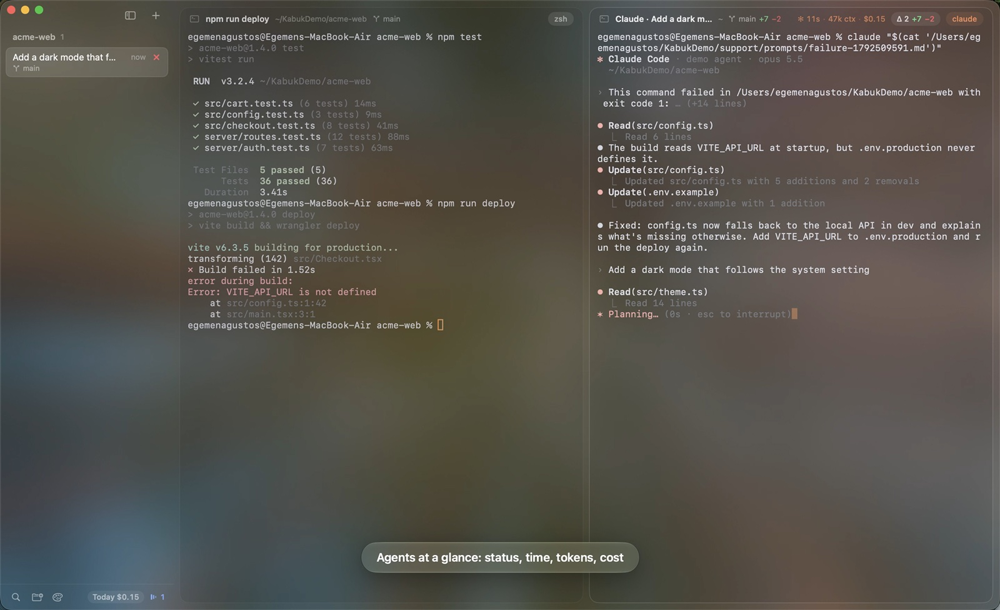

### Parallel agents in worktrees

**⌥⌘T** opens a new session in a fresh git worktree (`~/.kabuk/worktrees/<repo>/<name>`, branch `kabuk/<agent>-<id>`) and starts Claude there. Codex and plain-shell versions are in the Session menu and the palette. Agents can work on the same repository at the same time without touching each other's files. When you close the session, Kabuk asks whether to remove the worktree. The branch is always kept.

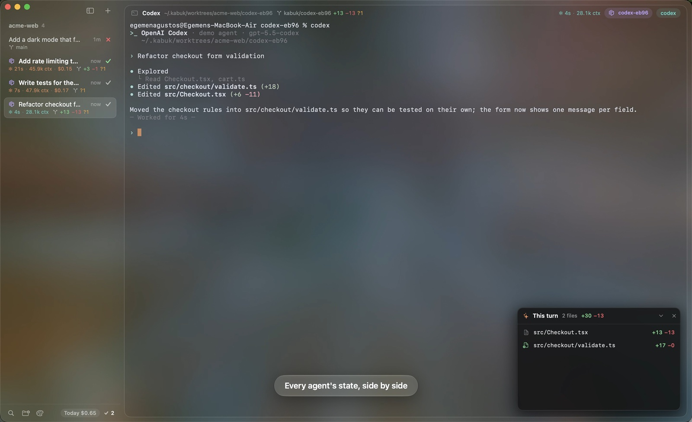

### Subagents and spawned agents under their session

When Claude starts subagents, they appear under its session in the sidebar and as chips along the bottom of its pane, each with its task, time, tool count and branch. Click one to follow its steps live. Subagents that can edit files get their own git worktree automatically, so several of them can work at once without overwriting each other. Explore and Plan stay in place. Turn this off with **Turn Off Subagent Worktrees** in the palette.

Claude can also hand a task to Codex, or to another Claude: ask it to, and it runs `"$KABUK_HOOK" spawn codex --prompt-file task.md`. Kabuk starts that agent in a new worktree session under Claude's, without switching away from what you're looking at. Worktree sessions you open with ⌥⌘T sit under the session you opened them from in the same way.

### Review & Merge

A worktree session's **Review & Merge** (context menu, palette, or when you close it) lists the branch's commits and every file it changed against your main checkout's branch. From there you can commit what's left, then merge, squash-merge or open a pull request with `gh`. A merge that hits conflicts is rolled back, so your main checkout is never left half-merged. Afterwards Kabuk can remove the worktree and branch. A subagent's worktree has the same review from its live view.

### Approve tool use from the sidebar

When Claude asks for permission in a session you aren't looking at, the request waits in the sidebar with **Allow**, **Always** and **Deny**. The notification has Allow and Deny buttons too. If the pane is on screen, or you switch to it, Claude asks in the terminal as usual.

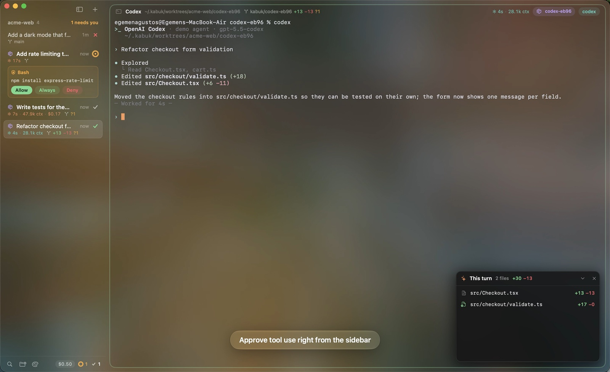

### What changed this turn

When an agent finishes a turn, a card lists the files it changed in that turn, with line counts. Click a file to see the diff. Changes that were already there before the turn aren't counted.

**Undo** puts every file the turn changed back the way it was, untracked files included, and moves the branch back if the agent committed. **Redo** brings the changes back.

Hover a line in the diff to leave a note on it. **Send to Claude** sends all your notes as one prompt, with file, line and code. If the agent is still working, the notes wait until its turn ends.

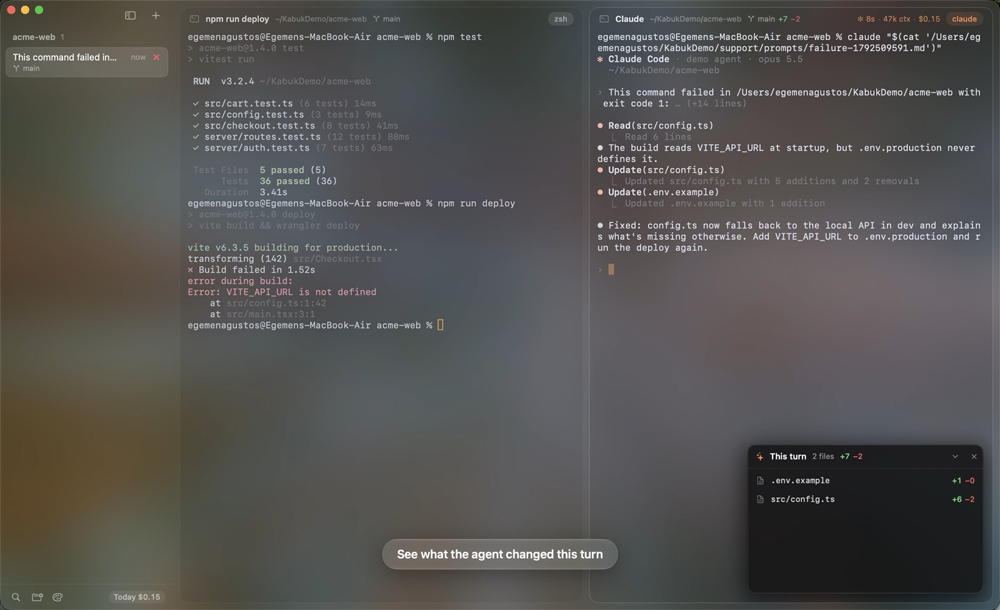

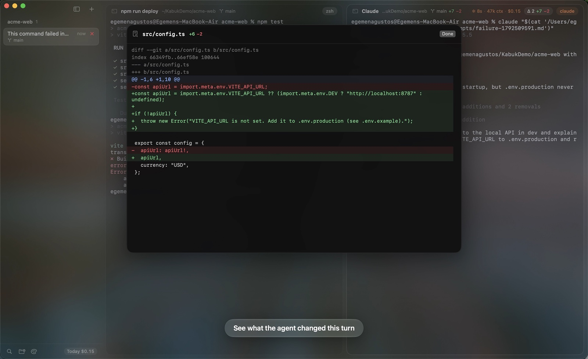

### Failed commands, handed to an agent

When a command fails, Kabuk has already captured its output. The **Ask Claude** (or **Codex**) chip sends the command, folder, exit code and the last 200 lines of output to an idle agent in the session, or opens one in a new pane.

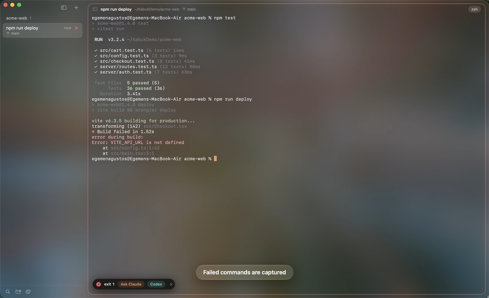

### Dev servers detected

When something started in a pane listens on a TCP port (`npm run dev`, `python -m http.server`, …), a `:5173` chip appears in the pane and the sidebar. Click it to open the page. It disappears when the server stops.

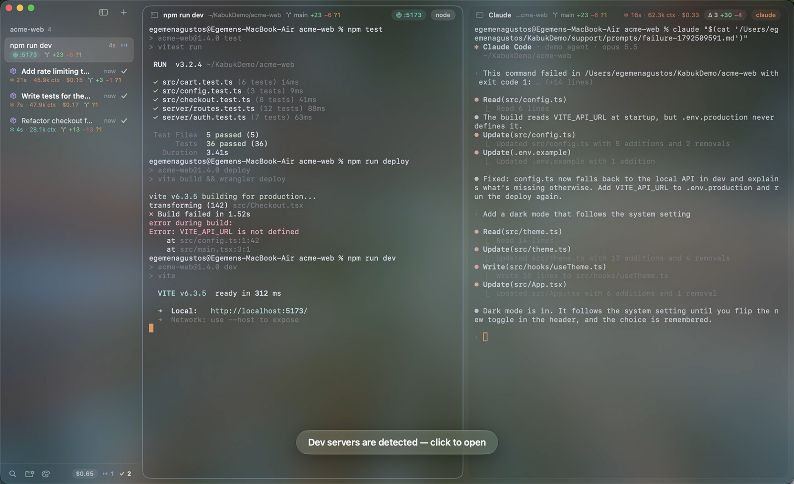

### Command palette

**⌘K** reaches every command: sessions, worktrees, splits, themes, transparency, integrations.

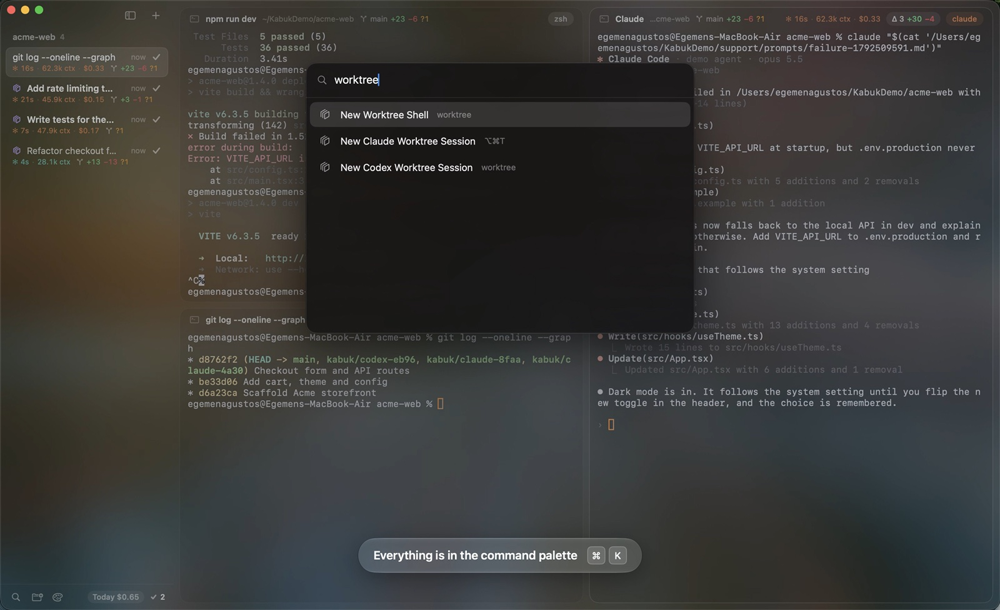

### History search

**⌘R** fuzzy-searches every command you've run in Kabuk, with the folder it ran in, plus your `~/.zsh_history`. Return puts the command at the prompt, ⌘Return runs it, and **This Folder** narrows the list to commands run where you are.

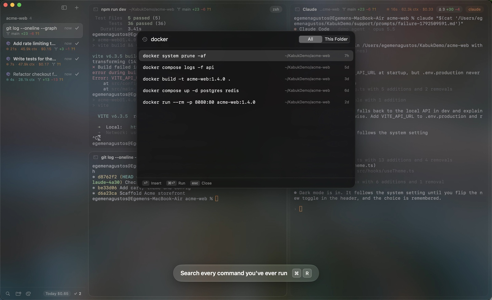

### Themes and glass

Seven built-in themes (Kabuk, Tokyo Night, Dracula, Nord, Gruvbox, Rosé Pine, Solarized Dark), plus your own JSON themes. Three transparency levels: **Glass**, **Tinted** and **Solid**. On macOS 26, overlays use Liquid Glass.

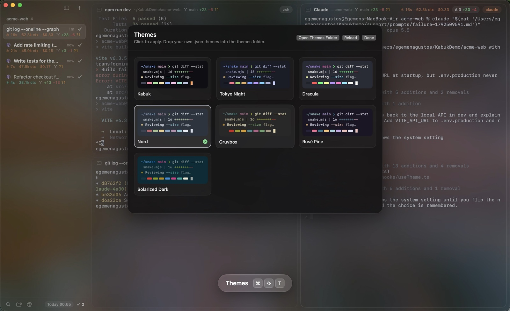

### Find in pane

**⌘F** with a live match count, **⌘G** / **⇧⌘G** to step through matches.

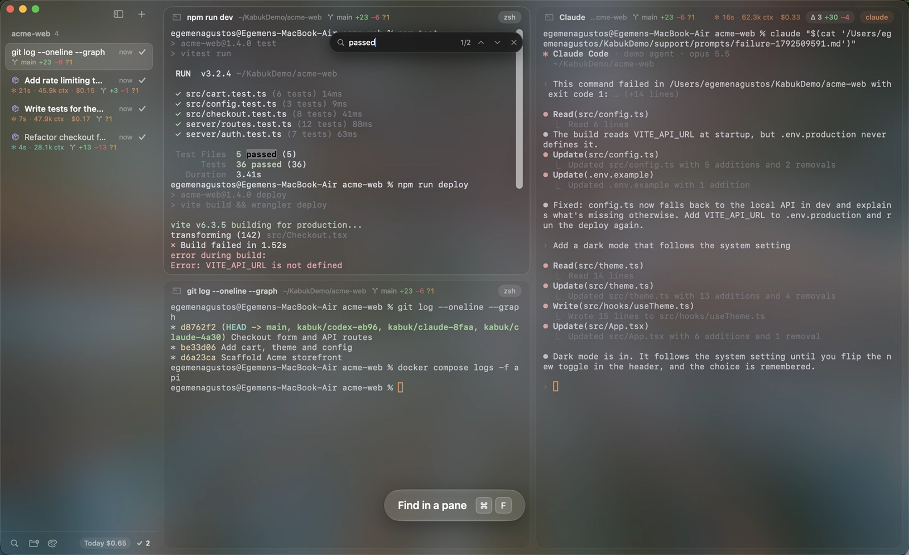

### And also

- **Split panes**: ⌘D and ⇧⌘D. Drag the gap between panes to resize them.
- **Git badges** for each pane: branch, ahead/behind, `+added −removed` and untracked files.
- **Cost tracking**: per session in the sidebar, and today's total in the status bar. Hover for the last seven days.
- **Plan limits**: how much of the Claude and Codex 5-hour and weekly limits you've used, as dots for the hours and dashes for the days in the status bar. Hover for percentages and reset times.
- **Notifications and a Dock badge** when an agent finishes or needs you, or a long command ends, while you're looking elsewhere.
- **Session restore**: sessions, splits and folders come back when you relaunch.
- **10,000 lines of scrollback** per pane.

## Install

Kabuk is built from source. It runs on macOS 14 or later. To build it you need Xcode 26 or later, because the macOS 26 SDK provides Liquid Glass. On older systems Kabuk falls back to a regular material.

```sh
git clone https://github.com/egemenagustos/Kabuk.git
cd Kabuk
scripts/build-app.sh          # builds build/Kabuk.app
open build/Kabuk.app
```

Copy `build/Kabuk.app` into `/Applications` to keep it. The app is signed ad hoc. If macOS refuses to open a copy you downloaded, right-click it and choose **Open**.

Releases with a ready-built `Kabuk-x.y.z.zip` are on the [releases page](https://github.com/egemenagustos/Kabuk/releases).

### Updating

From 0.2.0 on, Kabuk keeps itself up to date:

- Once a day it asks GitHub for the list of releases. When there's a newer one, a chip at the bottom of the sidebar says so. Click it to read what changed in every version since yours.
- **Install and Restart** downloads the release, checks that it's Kabuk at that version with an intact signature, quits, swaps it in and opens it again. Your sessions, splits and folders come back; whatever was running in them stops, and Kabuk warns you first.
- **Install When I Quit** downloads it now and swaps it in when you next quit Kabuk, so nothing running is interrupted.
- When Kabuk can't replace itself (for example, it can't write to the folder it's in), **Download** opens the release page instead.
- The first launch of a new version shows **What's New**, and offers to update the Claude Code hooks if the new features need more of them.

**Kabuk → Check for Updates…** checks right away. **Skip This Version** hides a release until a newer one comes out. The daily check can be turned off from the palette (⌘K, "update checks").

0.1.0 can't update itself: download 0.2.0 once from the releases page (or pull and rebuild), and later versions arrive on their own.

Kabuk runs your login shell. The zsh integration (status, failed-output capture, history) is zsh-only. Other shells work as plain terminals.

## Connect Claude Code and Codex

Choose **Kabuk → Install Claude/Codex Integration…**, or press ⌘K and type "integration".

- **Claude Code** gets `UserPromptSubmit`, `PreToolUse` (only for starting subagents), `PostToolUse`, `Notification`, `Stop`, `PermissionRequest`, `SubagentStart` and `SubagentStop` hooks in `~/.claude/settings.json`, a status line command that passes your plan limits to Kabuk (it still runs your own status line, if you have one), and the `kabuk-delegate` skill in `~/.claude/skills`. When a newer Kabuk needs more hooks, it offers to update them.
- **Codex** gets a `notify` line in `~/.codex/config.toml`.

The first install backs up both files as `*.kabuk-backup`. The hooks only do something inside Kabuk panes. In any other terminal they exit immediately. The same menu removes them.

## Shortcuts

| Shortcut | Action |
|---|---|
| ⌘T | New session |
| ⌥⌘T | New Claude worktree session |
| ⌘O | Open project folder |
| ⌘D / ⇧⌘D | Split right / down |
| ⌘W / ⇧⌘W | Close pane / session |
| ⌥⌘ + arrow keys | Move between panes |
| ⌘F, ⌘G, ⇧⌘G | Find, next, previous |
| ⌘R | Search command history |
| ⌘K | Command palette |
| ⌘\\ | Toggle sidebar |
| ⇧⌘T | Themes |
| ⇧⌘[ ⇧⌘] / ⌘1…9 | Switch session |
| ⇧⌘R | Rename session (or double-click the row) |
| ⌘+ ⌘− ⌘0 | Text size |

## Status at a glance

| Icon | Meaning |
|---|---|
| Three rising and falling blue bars | A command is running |
| Orange ✻ morphing (Claude) / teal ✻ (Codex) | The agent is working; the pane border glows |
| Pulsing amber ring | The agent needs you, for example to approve a permission |
| ✓ | Done |
| Red ✕ with a shake | The command failed |

## Customizing

### Themes

Drop JSON files into `~/Library/Application Support/Kabuk/themes`. **Open Themes Folder** in the gallery puts an editable copy of the current theme there.

```json
{
  "id": "my-theme",
  "name": "My Theme",
  "background": "#0f0f14",
  "foreground": "#dcdee8",
  "cursor": "#fa9e5c",
  "ansi": ["#45475a", "#f38ba8", "… 16 colors in total …"]
}
```

### Prices

Claude prices are built in. To price Codex models, or to change any price, add `~/Library/Application Support/Kabuk/pricing.json`. Prices are in USD per million tokens. The numbers below are only an example of the format.

```json
{ "models": { "gpt-5.5-codex": { "input": 1.25, "output": 10, "cacheRead": 0.125 } } }
```

The cost is what the same usage would cost on the API. On a Claude or ChatGPT subscription you aren't billed per token.

### Files

Everything lives in `~/Library/Application Support/Kabuk/`:

| File | What it holds |
|---|---|
| `state.json` | Sessions, splits, folders and settings |
| `history.jsonl` | Commands run in Kabuk, with their folders |
| `usage.json` | The cost ledger |
| `limits.json` | The latest Claude and Codex plan limits |
| `pricing.json` | Optional price overrides |
| `themes/` | Your themes |
| `shell/` | The zsh integration, rewritten at launch |
| `kabuk.sock` | The socket that hooks talk to |
| `subagent-worktrees-off` | Present while subagent worktrees are turned off |
| `prompts/` | Prompts handed to agents started by Kabuk |
| `Updates/` | A downloaded update until it's installed |

## How it works

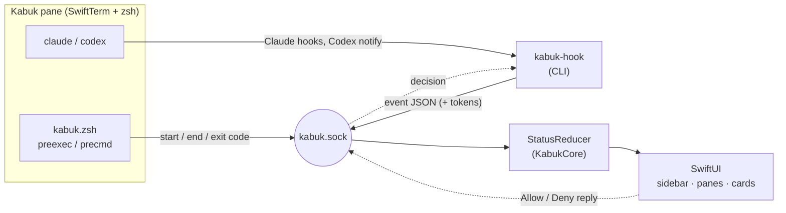

- **`Sources/KabukCore`**: everything that can be tested without a window. This includes:
  - the status state machine (`StatusReducer`) and the split tree (`PaneNode`)
  - parsers for git status, Claude transcripts, Codex rollouts, zsh history and `lsof`
  - pricing, turn diffs, worktree naming and the integration installer
  - unit tests for all of it
- **`Sources/Kabuk`**: the app. This includes:
  - SwiftUI and AppKit views, SwiftTerm panes and the Unix socket server
  - services for git, worktrees, ports, history, usage and notifications
  - the Metal background
- **`Sources/kabuk-hook`**: a small CLI the agents call. It forwards hook events and token counts to the app. For a permission request it keeps the connection open, waits for the answer and prints Claude's decision JSON.
- **The zsh integration** loads your own zsh startup files first. It then adds command start/end reporting, plus invisible OSC 6973 marks around each command so Kabuk can read back exactly what a failed command printed.

## Contributing

Issues and pull requests are welcome. See **[CONTRIBUTING.md](CONTRIBUTING.md)** for setup, the project layout, testing, and how to drive and record the app from scripts.

```sh
swift build          # debug build
swift test           # KabukCore unit tests
scripts/build-app.sh # the .app bundle
```

## Privacy

The only network request Kabuk makes is the daily update check: it asks `api.github.com` for this repository's list of releases, and downloads a release when you choose to install it. Nothing about you or your work is sent. You can turn the check off from the palette.

Everything Kabuk records stays in `~/Library/Application Support/Kabuk/`:
- commands and their folders
- token counts and costs
- how much of your plan limits you've used
- your sessions

Token counts and plan limits come from the agents' own files on your disk and from Claude Code's status line.

## License

[MIT](LICENSE)
